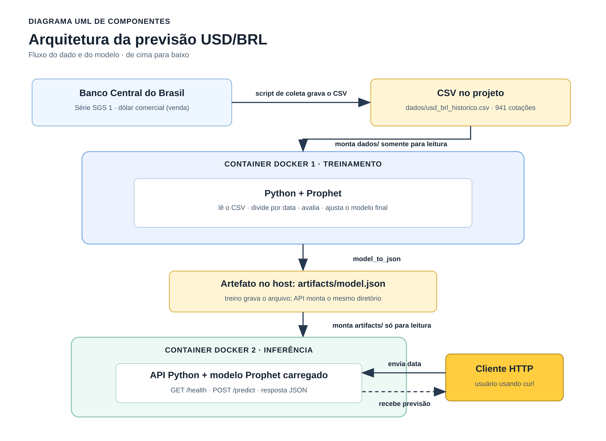
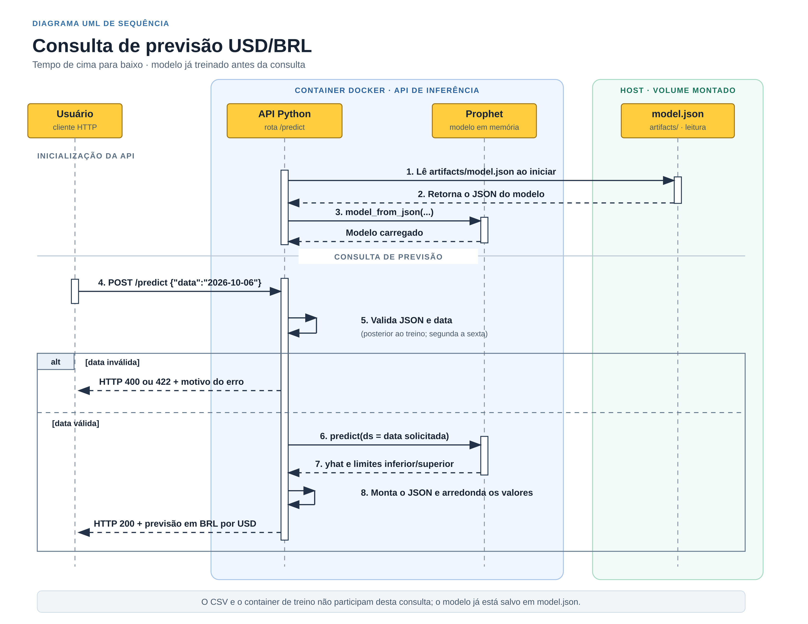
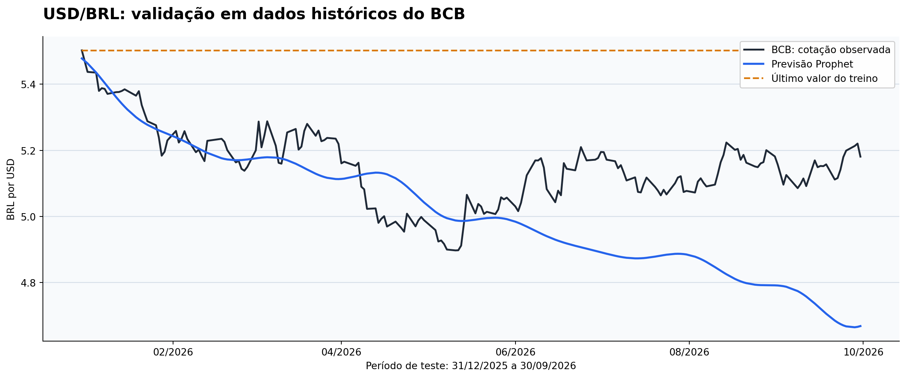

# Previsão experimental do dólar com Prophet e Docker

Esta entrega demonstra o caminho de um dado em CSV até uma previsão HTTP: usamos o histórico diário da cotação de venda do dólar comercial publicado pelo Banco Central do Brasil, treinamos um modelo Prophet em um container, salvamos o modelo em JSON e o carregamos em um segundo container com uma API Python. As previsões são **experimentais** e não devem ser usadas para decisões financeiras.

O [devlog](DEVLOG.md) registra a sequência do trabalho, os comandos executados, os problemas e as correções.

## Organização dos arquivos

```text
.
├── README.md                  # documentação e comandos de execução
├── DEVLOG.md                 # registro cronológico do trabalho
├── src/                      # coleta do CSV, treinamento, API e gráfico
├── docker/                   # Dockerfiles e dependências do Python
├── dados/                    # CSV histórico usado no treinamento
├── artifacts/                # modelo, métricas e validação salvos
└── docs/                     # enunciado, diagrama e gráfico
```

Execute os comandos deste README a partir da raiz do projeto. Antes de subir a API, execute o treinamento para gerar `artifacts/model.json`.

## 1. Pesquisa inicial e escolha da abordagem

O [enunciado](docs/enunciado.md) pede treinamento em Docker ou notebook, artefato do modelo, backend Python em outro container, diagrama UML, chamada de predição e devlog. Escolhemos o valor de **1 USD em BRL** como variável a prever e o [Prophet](https://facebook.github.io/prophet/docs/quick_start.html) para a série temporal. A documentação do Prophet pede um dataframe com `ds` (data) e `y` (valor), e mostra `fit` e `predict`. Para transferir o modelo entre containers, usamos o [formato JSON recomendado na documentação](https://facebook.github.io/prophet/docs/additional_topics.html).

Consultamos as fontes sugeridas no enunciado antes de definir a base:

| Fonte | O que encontramos para este projeto |
| --- | --- |
| [Banco Central — série SGS 1](https://dadosabertos.bcb.gov.br/dataset/1-taxa-de-cambio---livre---dolar-americano-venda---diario) | Fonte escolhida: dólar comercial, cotação diária de venda em BRL por USD. |
| [Yahoo Finance — USD/BRL](https://finance.yahoo.com/quote/BRL%3DX/history/) | Oferece histórico diário de `BRL=X`; seria outra opção para cotações reais. |
| [CryptoDataDownload](https://www.cryptodatadownload.com/) | Focado em séries históricas de criptoativos. |
| [Kaggle Datasets](https://www.kaggle.com/datasets) | Catálogo de bases; cada conjunto exigiria checagem de origem e qualidade. |
| [Binance Spot API](https://developers.binance.com/en/docs/catalog/core-trading-spot-trading/api/rest-api/market) | Oferece candles de pares negociados na plataforma, com mais trabalho de coleta. |
| [CoinGecko API](https://docs.coingecko.com/) | Voltada a dados de criptoativos. |
| [Google Dataset Search](https://datasetsearch.research.google.com/) | Ajuda a encontrar bases, mas não é uma série USD/BRL por si só. |

Primeiro usamos dados sintéticos para montar o fluxo. Depois substituímos a base pelo histórico oficial do Banco Central para atender ao pedido do enunciado de treinar com dados históricos. O CSV fica salvo no repositório, então o treino não depende de internet; a conexão só é necessária para baixar a base de novo.

## 2. Criação da base em CSV

O arquivo [dados/usd_brl_historico.csv](dados/usd_brl_historico.csv) tem as colunas `data` e `cotacao_brl_por_usd`. São **941 cotações observadas**, de `2023-01-02` a `2026-09-30`. A fonte é a [série SGS 1 do Banco Central](https://dadosabertos.bcb.gov.br/dataset/1-taxa-de-cambio---livre---dolar-americano-venda---diario), que identifica a taxa como dólar americano comercial, venda, diária. O recorte foi fixado para tornar esta execução comparável e o SHA-256 do CSV usado no treino é `61d7477f411933a48404087af0a10b15b718fd80f6b18454c833a0d0e47d34df`.

O [script de coleta](src/baixar_cotacoes_usd_brl.py) consulta a API do Banco Central, confere datas e valores e grava o CSV. Para refazer a coleta com internet:

```bash
python3 src/baixar_cotacoes_usd_brl.py
```

Conferimos as 941 linhas com a resposta da API, além de ordem cronológica, ausência de duplicatas e valores positivos. Feriados sem cotação não aparecem no arquivo. Uma nova coleta pode refletir revisões feitas pelo Banco Central; o CSV entregue é o registro exato usado nos resultados abaixo. A [licença do conjunto de dados](https://dadosabertos.bcb.gov.br/dataset/1-taxa-de-cambio---livre---dolar-americano-venda---diario) é ODbL.

## 3. Diagramas UML

O diagrama de arquitetura mostra os componentes pedidos no enunciado: CSV histórico, container de treinamento, artefato `model.json`, container da API e cliente HTTP. O treinamento grava o artefato na pasta `artifacts/` do host, e a API monta essa mesma pasta somente para leitura. Esse é o caminho do modelo entre os dois containers.



O segundo diagrama detalha **uma consulta de previsão**, de cima para baixo. Quando o container da API inicia, ele lê `artifacts/model.json` do volume montado e carrega o modelo Prophet em memória. Depois, o usuário envia uma data para `POST /predict`; a API valida a entrada, calcula a previsão e devolve um JSON. Se a data for inválida, ela responde com um erro. A criação do CSV e o treinamento acontecem antes desse fluxo.



## 4. Treinamento e salvamento do modelo

O [código de treinamento](src/treinar_modelo.py) renomeia as colunas do CSV para `ds` e `y`, valida os dados e separa treino e teste **por data, sem embaralhar**.

Usamos **multistage build** no [Dockerfile.treino](docker/Dockerfile.treino). A etapa `builder` cria `/opt/venv` e instala as dependências; a etapa `runtime` começa de uma nova imagem `python:3.11-slim`, copia só esse ambiente virtual e o script de treinamento. Assim, o arquivo de requisitos e os passos de instalação ficam fora da imagem final. Escolhemos essa divisão para deixar explícito o que é preparação e o que é execução. Comparamos os tamanhos: a imagem de treino com multistage ficou em **643 MB**, contra **605 MB** na versão anterior. Portanto, neste projeto a divisão funcionou, mas **não trouxe redução de tamanho**; as dependências do Prophet ainda precisam estar no `runtime`.

Na raiz do repositório, execute:

```bash
docker build --network=host -f docker/Dockerfile.treino -t ponderada-dolar-treino:latest .
mkdir -p artifacts
docker run --rm --network none --user "$(id -u):$(id -g)" \
  -v "$PWD/dados:/app/dados:ro" \
  -v "$PWD/artifacts:/app/artifacts" \
  ponderada-dolar-treino:latest
```

O `--network=host` foi necessário **no build deste ambiente** por uma falha de DNS do Docker; em um ambiente sem esse problema, pode ser omitido. O `--user` usa seu UID/GID para criar os artefatos com o mesmo dono dos arquivos locais. O treino roda sem rede. Ele grava:

| Arquivo | Finalidade |
| --- | --- |
| [artifacts/model.json](artifacts/model.json) | Modelo Prophet ajustado com todas as 941 cotações, usando `model_to_json`. |
| [artifacts/metricas.json](artifacts/metricas.json) | Fonte, SHA-256 do CSV, datas da separação e erros medidos. |
| [artifacts/previsoes_validacao.csv](artifacts/previsoes_validacao.csv) | Cotações observadas e previsões no teste. |
| [artifacts/previsao_exemplo.json](artifacts/previsao_exemplo.json) | Exemplo calculado após recarregar `model.json` com `model_from_json`. |

## 5. Avaliação do desempenho

Os primeiros **753 registros**, de `2023-01-02` a `2025-12-30`, foram usados no treino da avaliação. Os **188 seguintes**, de `2025-12-31` a `2026-09-30`, ficaram para teste. A avaliação prevê **todo esse bloco a partir do fim do treino**, sem incorporar os valores do teste ao modelo. Como comparação, a referência simples repete a última cotação do treino para todas as datas de teste.

| Método | MAE (BRL por USD) | RMSE (BRL por USD) |
| --- | ---: | ---: |
| Prophet | **0,165211** | **0,217971** |
| Última cotação do treino | 0,352412 | 0,370360 |

O MAE do Prophet corresponde a cerca de **16,5 centavos por dólar** no período de teste, contra **35,2 centavos** da referência. O RMSE dá mais peso aos erros altos. Nesse recorte histórico, o Prophet superou a referência simples, mas isso não garante o mesmo resultado em outros períodos nem em uso financeiro real.



No gráfico, a curva do Prophet acompanha a queda no começo do teste, mas depois continua caindo enquanto as cotações observadas se recuperam. Perto do fim, a previsão fica bem abaixo dos valores reais. Por isso, a média dos erros deve ser lida junto com o gráfico. O [script do gráfico](src/gerar_grafico_validacao.py) usa `artifacts/previsoes_validacao.csv` para reproduzir essa figura.

## 6. Interação do usuário com o modelo

O [backend Python](src/api.py) roda em um **segundo container**, definido em [Dockerfile.api](docker/Dockerfile.api). Esse Dockerfile também tem duas etapas: `dependencias` usa a imagem de treino já construída, e `runtime` parte de `python:3.11-slim`, copia o mesmo `/opt/venv` e adiciona só `api.py`. Por isso, **a imagem de treino precisa ser construída antes da imagem da API**. Reaproveitar o ambiente evita instalar uma versão diferente do Prophet na API. Ao iniciar, ela monta `artifacts/` somente para leitura e carrega `model.json`; cada consulta usa o modelo já treinado.

Depois do treino, construa e inicie a API:

```bash
docker build --network=host -f docker/Dockerfile.api -t ponderada-dolar-api:latest .
docker run -d --rm --name ponderada-dolar-api \
  --user "$(id -u):$(id -g)" -p 127.0.0.1:8765:8000 \
  -v "$PWD/artifacts:/app/artifacts:ro" \
  ponderada-dolar-api:latest
```

Verifique se o serviço está ativo e peça uma previsão:

```bash
curl http://127.0.0.1:8765/health
curl -X POST http://127.0.0.1:8765/predict \
  -H 'Content-Type: application/json' \
  -d '{"data":"2026-10-06"}'
```

No teste realizado com o novo modelo, `/health` retornou `HTTP 200` e informou que o modelo estava carregado até `2026-09-30`. `/predict` também retornou `HTTP 200`, com previsão pontual de **5,2152 BRL por USD** para `2026-10-06`, além dos limites inferior e superior. Um domingo foi rejeitado com `HTTP 422`. A API aceita uma data posterior ao fim do treino, de segunda a sexta; não trata feriados.

Exemplo de resposta observada em `/predict` (os limites podem variar entre execuções):

```json
{"data":"2026-10-06","previsao_brl_por_usd":5.2152,"limite_inferior":5.123,"limite_superior":5.3048,"unidade":"BRL por USD","dados":"histórico BCB/SGS 1; previsão experimental"}
```

O **modelo é salvo** em `artifacts/model.json` pelo treinamento. As métricas e previsões de validação também ficam em `artifacts/`. A resposta de `/predict` é devolvida em JSON ao cliente e **não é gravada automaticamente** em outro arquivo. Para encerrar o serviço, execute `docker stop ponderada-dolar-api`.

## 7. Limitações e próximos passos

- A base é histórica, mas o modelo continua experimental e não é adequado para orientar decisões financeiras.
- O teste mede um bloco futuro de 188 observações a partir de um único corte temporal. Seriam necessários outros períodos de validação para avaliar estabilidade.
- O recorte da base termina em `2026-09-30`; a API não consulta cotações novas sozinha. É preciso baixar uma base atualizada e treinar de novo para incorporá-las.
- Os limites retornados pelo Prophet são do modelo, não garantia de preço futuro.
- As chamadas à API foram demonstradas com `curl`. Uma interface gráfica não faz parte desta entrega.
- O [devlog](DEVLOG.md) contém os erros encontrados, inclusive a primeira falha de DNS no build, e a sequência das decisões e testes.
